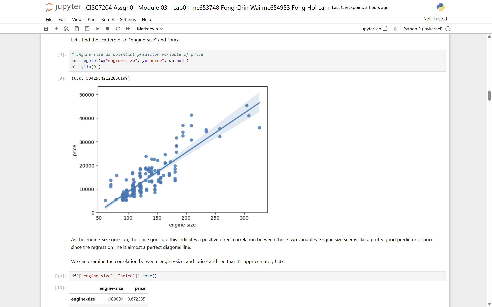
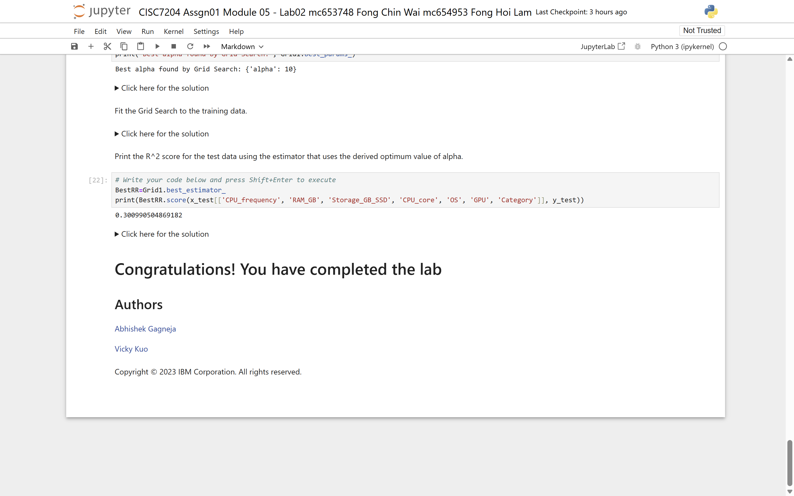
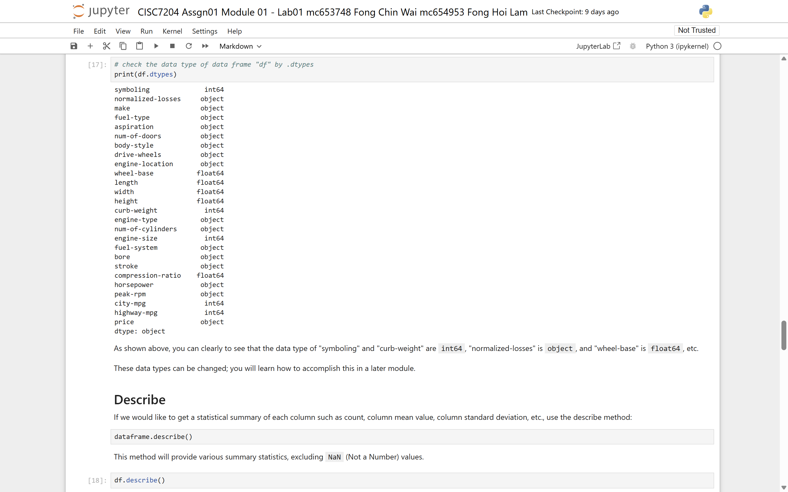
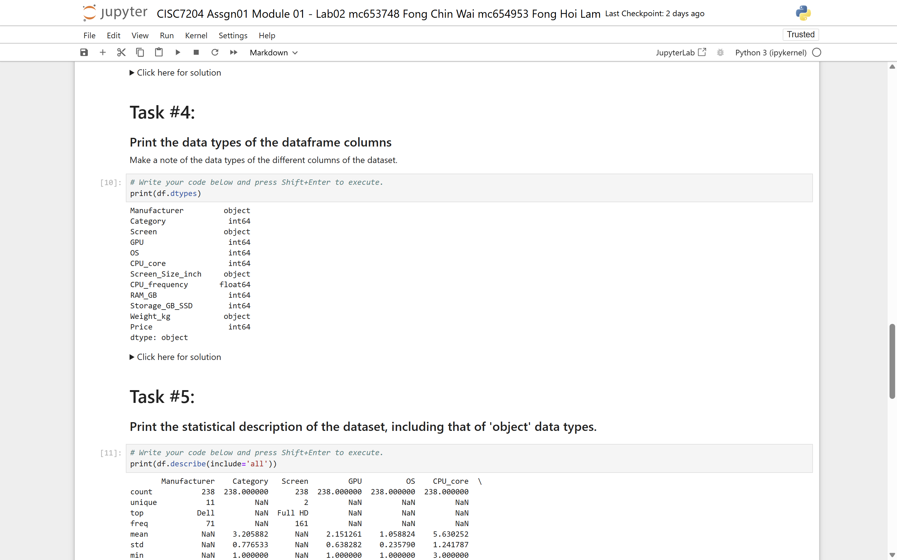
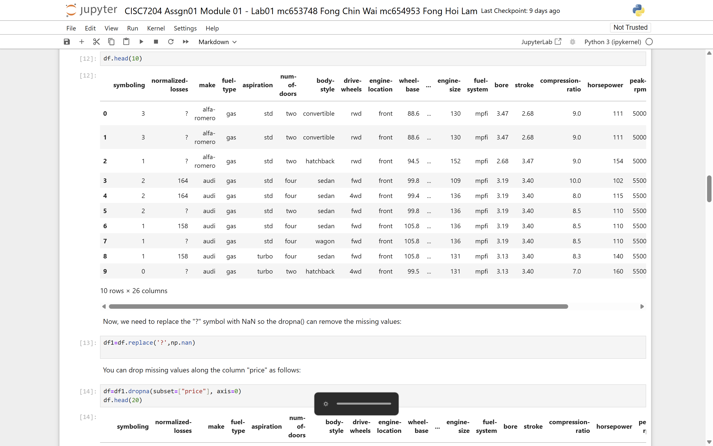
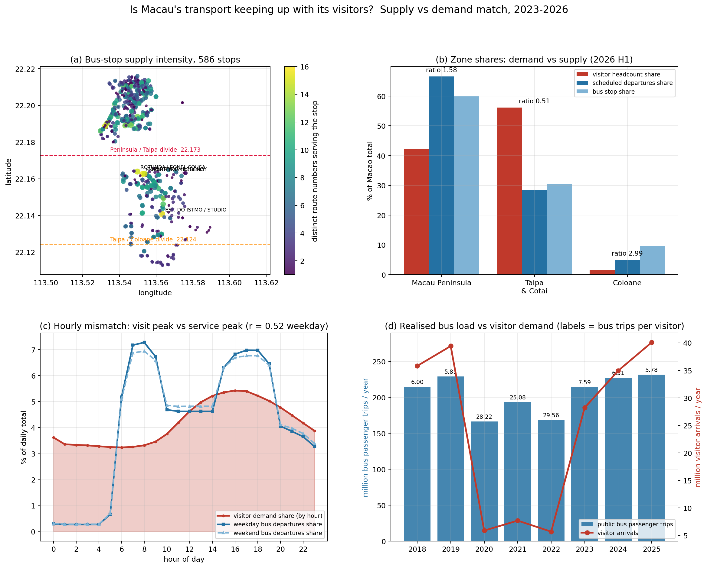
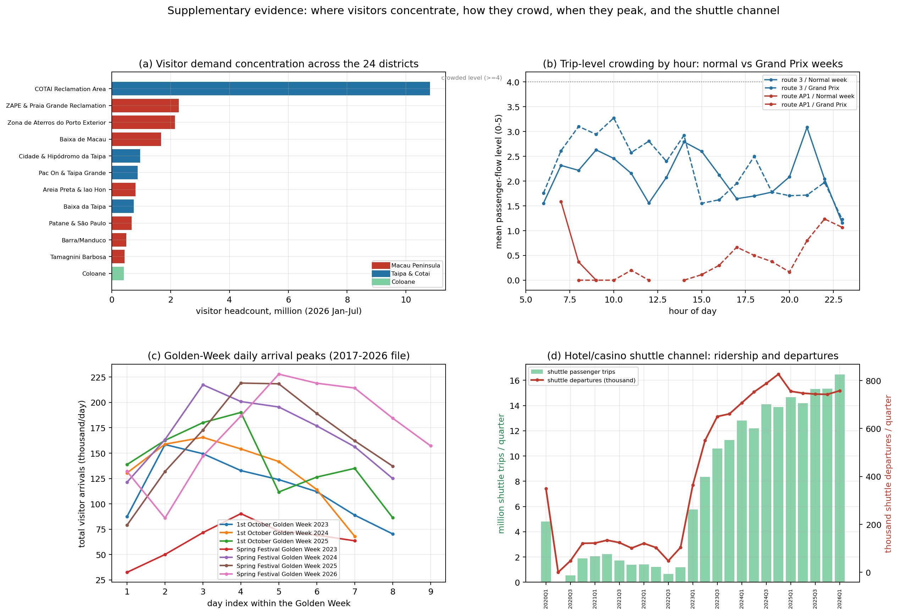

# Fong Chin Wai (Vivi)

MSc Data Science, University of Macau — Student ID: mc653748

Data science enthusiast working with Python to turn raw data into clean,
reproducible analyses and clear visualizations.

## Technical Skills

- **Programming:** Python, SQL
- **Data Manipulation:** Pandas, NumPy
- **Visualization:** Matplotlib, Seaborn
- **Machine Learning:** Scikit-learn (linear & Ridge regression, cross-validation, model evaluation)
- **Tools & Workflow:** Jupyter Notebook, Git, GitHub, GitHub Pages

## Projects

### 1. Regression Analysis for Pricing Prediction — *completed*

[data-science-project repository](https://github.com/FongChinWai-Vivi/data-science-project)

**Research question:** How accurately can the market price of a product or property
(used cars, laptops, and houses) be predicted from its features using regression models?

Using pandas, scikit-learn and matplotlib, I built and refined linear regression models
across six modules: data acquisition, wrangling, EDA, linear regression, and finally
cross-validation with Ridge regression and grid-search tuning. The analysis shows that
**engine size and horsepower dominate automobile price, while square footage dominates
house price**; Ridge regression with a tuned alpha clearly improves test-set R² compared
with plain polynomial regression.

*Engine size shows a clear positive relationship with automobile price.*

*Cross-validation and Ridge regression improve test performance.*

*Grid search identifies the best ridge regularization strength.*

*Data exploration steps from the assignment:*

*Inspecting data types and handling `?` missing values with `NaN` before modeling.*

**Notebooks:** [Download from the project repository](https://github.com/FongChinWai-Vivi/data-science-project/tree/main/notebooks)

**Status:** completed

---

### 2. Is Macau's Transport Keeping Up With Its Visitors? — *completed*

[Preliminary project repository](https://github.com/FongChinWai-Vivi/CISC7204-MC653748-2026GitHub)

**Research question:** Does Macau's public transport network supply match the demand
created by its rapidly growing visitor arrivals, especially during peak events?

This preliminary study combines visitor arrival data with bus route and stop data to
compare transport supply and demand across districts and time periods.

*586 bus stops mapped by service coverage: the Macau Peninsula has the densest network,
followed by Cotai.*

*Visitor demand is concentrated in the Macau Peninsula while Cotai's supply is relatively
more sufficient — Coloane shows the highest supply–demand ratio (2.99).*

**Status:** completed

---

*Hosted with GitHub Pages. Built for CISC7204 Practice 9 (Build Your Data Science Portfolio).*

